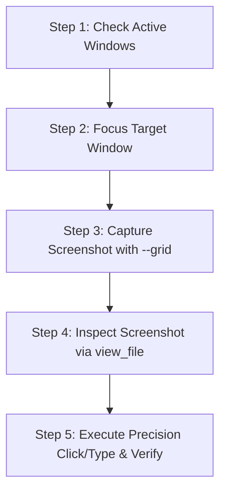

# Computer Use Skill (Desktop Automation Agent)

## Overview

The `computer-use` skill equips the AI assistant with an autonomous desktop automation engine designed specifically for Windows systems, serving as an exact analog and extension of OpenAI Codex's native Computer Use Agent and Anthropic Computer Use.

It implements the full **Observe-Decide-Act** agentic loop:
1. **Perception**: High-fidelity, Per-Monitor DPI-aware screen capture with visual coordinate grids (`--grid`) and target markers (`--cursor`).
2. **Precision Mouse Actions**: Direct pixel-perfect cursor movement, single/double/triple clicks, right-click, middle-click, smooth drag-and-drop, and mouse wheel scrolling.
3. **Keyboard & Text Automation**: Unicode typing via `SendInput` (supporting Russian, English, emoji, and symbols), instant clipboard-based pasting (`paste`), and complex shortcut combinations (`hotkey`).
4. **Window Management**: Enumeration of active desktop applications, window bounding boxes, and foreground focus switching.
5. **Batch Execution & Failsafe**: Multi-step action pipelines with fail-safe corner abort protection.

---

## When to Use This Skill

Activate this skill when the user asks to:
- Interact with any desktop application (browsers, IDEs, office suites, settings, system dialogs).
- Click specific visual UI elements, buttons, menus, or links on the screen.
- Fill out desktop forms, type text into active fields, or paste code snippets.
- Navigate multi-step desktop workflows (e.g. open application -> search -> click result -> copy data).
- Capture screenshots with a coordinate ruler to locate UI elements with pixel accuracy.
- Manage desktop windows (focus, switch between windows, minimize, restore).

---

## Bundled Tooling & Script Location

The skill scripts are located in:
`<SKILL_DIR>/scripts/` (e.g. `C:\Users\artem\.gemini\config\skills\computer-use\scripts\` or `~/.config/opencode/skills/computer-use/scripts/`)

The primary unified entry point is `computer.py`:
```bash
python scripts/computer.py <command> [args...] [--json]
```

---

## Core Capabilities & Command Reference

### 1. Screen Perception (`screenshot`)

Captures the physical screen using high-speed native GDI `BitBlt` with Per-Monitor DPI awareness.

```bash
# Capture full screen and save to specific path
python C:\Users\artem\.gemini\config\skills\computer-use\scripts\computer.py screenshot C:\temp\screen.png

# Capture full screen with 100px coordinate grid overlay (HIGHLY RECOMMENDED for AI visual grounding)
python C:\Users\artem\.gemini\config\skills\computer-use\scripts\computer.py screenshot --grid C:\temp\screen_grid.png

# Capture screenshot showing current mouse cursor position with a red target crosshair
python C:\Users\artem\.gemini\config\skills\computer-use\scripts\computer.py screenshot --grid --cursor C:\temp\screen_marked.png

# Highlight specific target coordinates with a crosshair before or after clicking
python C:\Users\artem\.gemini\config\skills\computer-use\scripts\computer.py screenshot --marker-x 450 --marker-y 200 C:\temp\target.png

# Capture specific rectangular region (X Y Width Height)
python C:\Users\artem\.gemini\config\skills\computer-use\scripts\computer.py screenshot --crop 100 100 800 600 C:\temp\crop.png
```

> [!TIP]
> **Visual Grounding with `--grid`**: Always use `--grid` when you need to find coordinates of UI elements. The grid renders clear pixel labels along the top/bottom and left/right axes every 100px with major red guide lines at 500px, eliminating guesswork when targeting buttons or text inputs.

---

### 2. Mouse Control (`click`, `move`, `drag`, `scroll`)

```bash
# Move cursor to physical coordinates (X, Y)
python C:\Users\artem\.gemini\config\skills\computer-use\scripts\computer.py move 500 300

# Smooth cursor movement over 0.3 seconds
python C:\Users\artem\.gemini\config\skills\computer-use\scripts\computer.py move 500 300 --smooth --duration 0.3

# Single left click at (X, Y)
python C:\Users\artem\.gemini\config\skills\computer-use\scripts\computer.py click 500 300

# Double click at (X, Y)
python C:\Users\artem\.gemini\config\skills\computer-use\scripts\computer.py double-click 500 300

# Right click (context menu) at (X, Y)
python C:\Users\artem\.gemini\config\skills\computer-use\scripts\computer.py right-click 500 300

# Drag and drop from (X1, Y1) to (X2, Y2)
python C:\Users\artem\.gemini\config\skills\computer-use\scripts\computer.py drag 200 400 600 400 --duration 0.5

# Scroll mouse wheel (positive = scroll up, negative = scroll down)
python C:\Users\artem\.gemini\config\skills\computer-use\scripts\computer.py scroll -5

# Scroll at specific coordinates
python C:\Users\artem\.gemini\config\skills\computer-use\scripts\computer.py scroll -5 --x 500 --y 300

# Get current cursor coordinates
python C:\Users\artem\.gemini\config\skills\computer-use\scripts\computer.py cursor --json

# Get primary display resolution
python C:\Users\artem\.gemini\config\skills\computer-use\scripts\computer.py screen --json
```

---

### 3. Keyboard & Text Input (`type`, `paste`, `press`, `hotkey`)

```bash
# Type Unicode text (supports Russian, English, punctuation, and emoji)
python C:\Users\artem\.gemini\config\skills\computer-use\scripts\computer.py type "Hello, World!"

# Fast and reliable paste (copies to clipboard and sends Ctrl+V) - Best for code, URLs, and multiline text
python C:\Users\artem\.gemini\config\skills\computer-use\scripts\computer.py paste "https://github.com/anthropics"

# Press single special key
python C:\Users\artem\.gemini\config\skills\computer-use\scripts\computer.py press enter
python C:\Users\artem\.gemini\config\skills\computer-use\scripts\computer.py press esc
python C:\Users\artem\.gemini\config\skills\computer-use\scripts\computer.py press tab
python C:\Users\artem\.gemini\config\skills\computer-use\scripts\computer.py press backspace

# Press hotkey shortcuts
python C:\Users\artem\.gemini\config\skills\computer-use\scripts\computer.py hotkey win r
python C:\Users\artem\.gemini\config\skills\computer-use\scripts\computer.py hotkey ctrl c
python C:\Users\artem\.gemini\config\skills\computer-use\scripts\computer.py hotkey ctrl v
python C:\Users\artem\.gemini\config\skills\computer-use\scripts\computer.py hotkey alt tab
python C:\Users\artem\.gemini\config\skills\computer-use\scripts\computer.py hotkey ctrl shift esc
```

---

### 4. Window & Workspace Management (`windows`, `focus`)

```bash
# List all visible windows on the interactive desktop with their bounds and HWNDs
python C:\Users\artem\.gemini\config\skills\computer-use\scripts\computer.py windows --json

# Bring window to foreground and focus (matches partial title or process name)
python C:\Users\artem\.gemini\config\skills\computer-use\scripts\computer.py focus "Firefox"
python C:\Users\artem\.gemini\config\skills\computer-use\scripts\computer.py focus "Code"
python C:\Users\artem\.gemini\config\skills\computer-use\scripts\computer.py focus "Notepad"

# Get info of the current active foreground window
python C:\Users\artem\.gemini\config\skills\computer-use\scripts\computer.py active-window --json

# Minimize or maximize window
python C:\Users\artem\.gemini\config\skills\computer-use\scripts\computer.py minimize "Firefox"
python C:\Users\artem\.gemini\config\skills\computer-use\scripts\computer.py maximize "Firefox"
```

---

### 5. Clipboard Integration (`clipboard`)

```bash
# Read current clipboard text
python C:\Users\artem\.gemini\config\skills\computer-use\scripts\computer.py clipboard get

# Set clipboard text
python C:\Users\artem\.gemini\config\skills\computer-use\scripts\computer.py clipboard set "Sample Text"
```

---

### 6. Batch Multi-Action Pipelines (`batch`)

Executes multiple operations in sequence in a single tool call, drastically reducing roundtrip delays:

```bash
python C:\Users\artem\.gemini\config\skills\computer-use\scripts\computer.py batch '[
  {"action": "focus", "window": "firefox"},
  {"action": "wait", "seconds": 0.3},
  {"action": "click", "x": 500, "y": 75},
  {"action": "paste", "text": "https://news.ycombinator.com"},
  {"action": "press", "key": "enter"},
  {"action": "wait", "seconds": 2.0},
  {"action": "screenshot", "grid": true, "path": "C:\\temp\\page.png"}
]' --json
```

Supported actions in `batch`:
- `click` (`x`, `y`, `button`, `count`)
- `double_click` (`x`, `y`)
- `right_click` (`x`, `y`)
- `move` (`x`, `y`, `smooth`, `duration`)
- `drag` (`x1`, `y1`, `x2`, `y2`, `duration`, `button`)
- `scroll` (`clicks`, `x`, `y`, `horizontal`)
- `type` (`text`, `delay`, `paste`)
- `paste` (`text`)
- `press` (`key`)
- `hotkey` (`keys`)
- `focus` (`window`)
- `minimize` (`window`)
- `maximize` (`window`)
- `clipboard` (`subcommand`: "get" | "set", `text`)
- `wait` (`seconds`)
- `screenshot` (`path`, `grid`, `cursor`, `marker_x`, `marker_y`, `crop`)

---

### 7. Visual Feedback & Google Border Overlay (`overlay`)

Provides active visual feedback while the AI controls the desktop:
- **Screen Perimeter Glow**: 6px frame in authentic Google colors (Blue, Red, Yellow, Green).
- **Top Status Pill**: Floating badge indicating `⚡ Antigravity is controlling your computer (Esc to cancel)`.
- **Animated Cursor Halo**: Multi-color target ring tracking the mouse pointer at 60 FPS.
- **100% Click-Through**: Completely non-blocking and transparent (`WS_EX_TRANSPARENT`).

```bash
# Start visual overlay for 10 seconds
python C:\Users\artem\.gemini\config\skills\computer-use\scripts\computer.py overlay start --duration 10.0

# Stop active overlay
python C:\Users\artem\.gemini\config\skills\computer-use\scripts\computer.py overlay stop

# Check overlay status
python C:\Users\artem\.gemini\config\skills\computer-use\scripts\computer.py overlay status --json
```

> [!NOTE]
> All `batch` operations automatically activate the visual overlay for the duration of the sequence and terminate it upon completion.

---

### 8. High-Speed Desktop Automation & Icon Launcher (`launch-icon`, `find-icon`)

Directly queries the Windows Explorer `SysListView32` desktop control to resolve icon names to physical coordinates in milliseconds (< 20ms), bypassing visual trial-and-error:

```bash
# List all desktop icons with their exact physical coordinates
python C:\Users\artem\.gemini\config\skills\computer-use\scripts\computer.py desktop-icons --json

# Find exact coordinates of a desktop shortcut in 20ms
python C:\Users\artem\.gemini\config\skills\computer-use\scripts\computer.py find-icon "Cristalix" --json

# Instant sub-second launch (activates overlay, shows desktop, moves, double clicks in < 0.4s!)
python C:\Users\artem\.gemini\config\skills\computer-use\scripts\computer.py launch-icon "Cristalix"
```

---

## Standard Agent Workflow: Autonomous UI Task

Follow this 5-step loop for any desktop automation task:



1. **Window Identification**:
   Run `computer.py windows --json` to locate the target window and its bounding box.

2. **Focus**:
   Run `computer.py focus "<Window Name>"` to bring it to the foreground.

3. **Perception**:
   Run `computer.py screenshot --grid <path>` to capture the window state with coordinate grid overlay.

4. **Visual Inspection**:
   Use `view_file` on the saved PNG path to visually locate buttons, inputs, or content. Use the grid lines and coordinate numbers along the borders to determine the exact `(X, Y)` position.

5. **Action & Verification**:
   Execute the required `click`, `type`, or `hotkey`. If doing a multi-step task, take another screenshot to confirm the result.

---

## Safety & Operational Guidelines

1. **Corner Fail-Safe**: Moving the mouse cursor to the top-left corner `(0, 0)` triggers an automatic safety abort during batch actions.
2. **Per-Monitor DPI**: Always rely on physical coordinates reported by `screen` and `--grid`. Do not apply manual scaling factors; the engine handles 1:1 pixel mapping automatically.
3. **Prefer `paste` for Large Text**: Use `computer.py paste "<text>"` instead of `type` when typing URLs, file paths, code, or large blocks of Russian/multilingual text to prevent key dropping or layout switching issues.
4. **Delays for UI Rendering**: Modern web applications and desktop programs take 100–500ms to open menus or load pages. Use `wait` (or `--duration`) between opening dialogs and clicking elements.
5. **Preserve User Context**: Avoid minimizing or closing windows with unsaved work unless specifically instructed by the user.
